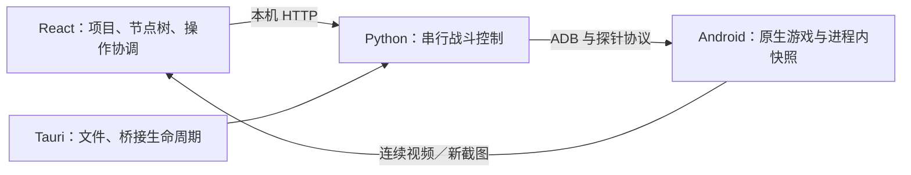

# 加载与节点切换性能

2026-10-15。结论：主要等待发生在 Android／原生游戏启动、战斗重建与截图取得；前端代码体积不是当前主要瓶颈。保留现有单桥接、单游戏进程的结构，优先复用已经验证的状态、重叠独立校验工作。

## 当前架构与耗时路径



- `src/domain/nativeReplay.ts` 管理项目和确定性的动作历史，`src/NativeApp.tsx` 协调会话及操作。业务状态与画面已有独立路径。
- `bridge/controller.py` 串行修改同一局战斗并核对摘要；`bridge/runtime.py` 管理模拟器、资源与身份验证；`bridge/video.py` 提供播放中的连续画面。
- 节点恢复应走“同进程快照 → 最近祖先快照加后续动作 → 种子与完整动作重放”。已有节点画面按项目、引擎、tick 和摘要缓存，只有确认状态一致后才能用于显示。
- 冷启动仍需要启动环境、校验内容、加载原生游戏和重放存档。原生快照是进程内句柄，重启游戏后必须重新建立。

## 本次实现

1. **再次打开同一项目复用快照。** 之前从首页继续会释放所有快照，再重建根战斗、重放至选中节点。现在只淘汰不兼容的缓存，直接从现有节点或祖先恢复。兼容性检查覆盖项目、引擎、初始配置及完整祖先动作历史；改备注、移动节点不使快照失效。日志事务恢复也执行相同检查。失效句柄会自动回退到经摘要核对的完整重放。
2. **并行校验 APK 与更新资源。** 两者读取独立文件，现在用一个临时工作线程重叠执行；全部通过后才能启动游戏。APK 变更时仍按原事务安装，并重新核对 APK、游戏库及探针。
3. **暂停截图直接编码 PNG。** 继续获取新的原生 RGBA 像素，使用 Python 标准库编码，无需每张图片启动 FFmpeg。保留两种 Android 截图头、透明通道和设备 PNG 回退。连续视频解码保持原流程。
4. **忽略相同状态的轮询结果。** 暂停时相同的桥接状态不会每 100 ms 触发整页更新。
5. **长路线恢复临时使用原生 4 倍速。** 重放后缀达到 20 tick 时加速推进，仍逐 tick 执行原版逻辑，并逐组核对手牌、形态、出牌事件及技能消耗。恢复完成或失败都会还原用户的播放速度；直接命中节点快照时不增加变速或推进请求。
6. **开局预推进支持临时 4 倍速。** 新战斗加载后，到首个可操作 tick 90 的过程使用同一原生时钟机制。必须精确停在 tick 90 并恢复普通时钟，再应用用户选择的播放速度。未改变 APK、探针、项目格式或引擎身份。

## 测量与边界

以下结果来自本机专用 `emulator-5560`，不能直接外推到其他电脑。

| 范围 | 优化前 | 优化后 | 测量方法 |
| --- | ---: | ---: | --- |
| 完整已安装运行时校验 | 3.76 s | 2.44 s | 同一已启动设备，旧／新实现交替各 3 次，取中位数，约减少 35% |
| 主机 PNG 编码 | 194 ms | 88 ms | 同一张 1080×1920 已录制原生画面，各 7 次，逐字节核对解码后的 RGBA，约减少 55% |

PNG 样本大小从约 2.52 MB 增至 2.87 MB，约增加 14%。现有画面缓存仍受 32 张／32 MiB 限制，复杂画面下可容纳的数量会略减；这是降低编码等待的取舍。

整条启动流程受模拟器磁盘缓存、Quick Boot 和游戏内容加载影响很大。本次旧实现热启动曾测得 40.8 s，新实现曾测得 23.5 s，但运行缓存条件不同，不能把总差值全部归因于代码变化。首次 Quick Boot 验收还出现过一次游戏停在启动画面的超时；完整冷启动后复查通过，因此没有消除这项已有启动不稳定性。

实际桌面端节点切换及首页继续的耗时由 `scripts/verify_desktop_app.mjs` 写入 `.local-runtime/desktop-check/report.json` 的 `nodeSwitch` 字段；它同时核对 tick、摘要、快照请求和实际画面完成状态。

本次真实桌面验收通过 13 项检查：6 次缓存节点切换为 67～105 ms，中位数 76 ms；从首页继续同一复盘为 263 ms，确认为一次快照恢复且没有新截图。首次访问无画面缓存的根节点为 878 ms。播放阶段实测 30 fps；单步、跨节点及迟到轮询响应的暂停同步均通过。这些结果使用现有调试版桌面宿主加载当前前端及 Python 源码。

## 长路线首次恢复

专用测试设备上的固定路线为 5802 tick，双方使用 16 级卡牌，包含普通出牌、觉醒弓箭手、骑士精英及一次主动技能，共 76 次动作。测试完全使用原生画面对局，没有用无画面结果替代画面模式的验证。

| 测量边界 | 原实现／1 倍速 | 当前实现 | 说明 |
| --- | ---: | ---: | --- |
| 从种子首次恢复至终局 | 292.36 s | 76.03 s | 约快 3.85 倍，减少约 74%；包含新战斗重建 |
| 重建后的 tick 推进等待 | 285.53 s | 72.10 s | 原生时钟临时使用 4 倍速，仍执行全部逻辑 tick |
| 新战斗重建至 tick 90 | 5.58 s | 2.34 s | 同一进程按 1／4／1／4 倍速交替测量，取中位数，开局摘要相同 |

“重建”包含场景创建与到 tick 90 的开局预推进；“tick 推进等待”单独累计其后的 `advance-native` 请求。以上不包含 Android 或游戏进程启动，也不包含最终截图取得。恢复后的实际原生播放速度会还原为用户设置。

测试在每次出牌、技能确认及终局核对摘要，共 77 个状态点，1 倍速与当前完整加速实现全部一致。终局为 tick 5802、皇冠 `[0,1]`、结果 `1`。原始路线按 SHA-256 固定为 `6acf1d6bbee58632a9857836b1e3b9de36d6d008cb8d7fdc26cf7e4b35919ef6`。

探针批量调度候选也单独测量：把技能前缀留在逐动作校验路径，再提前排入后续 70 次出牌，检查执行收据、形态、若干中间摘要和终局。当前协议按卡牌 ID 选择手牌，没有存档槽位字段；技能队列按名称解析，没有绑定存档的实体 ID。因此即使合法路线的终局一致，也不能直接替代正式恢复中的槽位与实体校验。该候选没有接入生产路径。

同一轮完整候选测得 75.10 s，相对正式路径的 76.03 s 仅减少约 0.93 s（1.2%，单次配对样本）。`advance-native` 请求从 128 次降至 45 次，普通捕获从 118 次降至 21 次，但又需要读取 70 份队列收据，最终仍受原生推进时钟限制。

跨分支验收从 tick 441 的同一快照生成两个不同落点的分支，分别核对其后缀摘要，并确认两分支确实不同。另实测拒绝错误技能实体与错误手牌槽位；同一张牌改用探针按 ID 调度后仍会执行，直接证明候选缺少存档槽位约束。直接恢复原快照约 24 ms，额外变速与推进请求均为零。

当前逐动作 4 倍速恢复中，普通状态捕获合计约 1.00 s、排入出牌约 0.23 s，主要耗时仍是约 72 s 的推进等待。若还需明显降低长路线等待，下一步应验证不依赖显示时钟的新原生快进机制，并为批量协议补齐槽位、形态和技能来源约束；仅减少现有队列请求不会带来与 4 倍速相同量级的收益。

## 验证与复测

自动检查覆盖兼容／变更历史的快照、失效快照回退、当前连接故障恢复、保存节点时画面缓存、完整资源校验、替换 APK 后重新验证，以及截图像素与透明通道。

第一轮前端构建、4 项旧版领域测试、38 项原生前端领域测试、75 项 Python 测试、18 项模拟前端检查及 13 项真实桌面检查均通过。长路线优化另增加开局时钟恢复、重放变速恢复、失败时不发布结果等检查，Python 测试现为 82 项；当前源码的长路线原生验收通过 10 项检查。桌面脚本原有的“只读配置没有任何 select”断言已改为检查没有可编辑控件，并确认双方塔楼选择框均禁用，与现有只读塔楼展示一致。

```powershell
npm.cmd run build
npm.cmd run test:domain
npm.cmd run test:native
npm.cmd run test:frontend

# 原生测量仅允许专用测试运行环境，不操作用户使用的 emulator-5556。
python -m scripts.verify_native_performance --runtime "$env:LOCALAPPDATA/cr-replay-clean-test" --output .local-runtime/native-performance.json

# 长路线：首次自动录制固定路线，再测量 1 倍速、4 倍速与队列候选。
python -m scripts.verify_long_replay --runtime "$env:LOCALAPPDATA/cr-replay-clean-test"

# 当前源码的真实桌面验收，先在另一终端运行 npm.cmd run web:dev。
npm.cmd run test:desktop -- src-tauri/target/debug/clash-replay-tree.exe "$env:LOCALAPPDATA/cr-replay-clean-test" http://127.0.0.1:1420
```

原始测量保存在被 Git 忽略的 `.local-runtime/startup-verification-comparison.json`、`.local-runtime/png-encoding-performance.json`、`.local-runtime/performance-before-ready.json` 和 `.local-runtime/performance-after.json`。前端模拟检查不代替真实原生引擎验收。

长路线最终报告为 `.local-runtime/long-replay/final-report.json`，路线为同目录 `route.json`；报告记录实现源码的 SHA-256、路线 SHA-256、每个已核对的摘要及分阶段请求计时。固定路线的 1 倍速基线保存为 `baseline-verified.json`，最终复查通过 `--baseline-report` 复用此基线，并重新验证同一路线哈希及全部 77 份摘要。

首轮脚本的分支样本在技能后圣水不足，后一次复查又暴露“初始场景未建立就设置速度”的脚本前置条件；均已修正。首轮已完成的 1／4 倍速及队列结果有效，但未把该失败轮描述为整套验收通过；最终完整报告的 `status` 为 `passed`。

## 后续优先级

- **进一步缩短长路线等待：** 当前已接近现有 4 倍速显示时钟的推进上限。若扩展探针快进／批量协议，需要先补齐槽位与技能来源验证，并重复跨分支、技能和终局摘要验收。
- **完全冷启动：** 重点定位 Quick Boot 后的游戏内容就绪阶段。缓存通过统计信息判断文件未变，不能替代现有完整身份校验。
- **大型节点树：** 只有出现大规模项目的前端测量瓶颈时，再做组件缓存或可见节点裁剪。当前没有增加服务、额外游戏实例、持久化快照格式或新的状态管理框架。

2026-10-15 已将本次修改打包为 0.3.11 并安装到本机，桌面快捷方式已切换到新名称和思考国王与棋子图标。安装后的程序通过独立首页检查及 13 组真实桌面验收；本次六次已访问节点切换为 60–91 毫秒，首次无快照返回根节点为 698 毫秒。长路线对比仍采用上文记录的源码验证数据，没有将其冒充为安装后的全路线重测。

## 沿途节点首次切换缓存

首次访问慢、再次访问快有两个来源：没有原生快照时需要重放动作，没有画面缓存时需要取得新截图。之前打开存档只保留根节点与最终节点的快照；中途经过的已保存节点没有进入缓存，首次点回这些节点仍需从根节点或祖先重放。

现在前端在同一条恢复请求中附上缺失的沿途节点，桥接按时间推进，在完整执行该 tick 的全部出牌／技能后核对节点摘要并创建快照，然后继续原来的路线。不会为此重放旁支。精确命中已有快照的请求不增加快照创建或推进操作。

前端仍保留最多 32 个原生快照并保护根节点，沿途采集每次最多 32 个，根节点已缓存时最多再采集 31 个；超出时保留根节点和靠近目标的节点，避免采集后立即淘汰。32 张／32 MiB 的画面缓存不变。快照分配失败不阻止已经核对通过的重放；动作、节点摘要或播放时钟恢复失败时，释放本次创建的所有快照，不发布缓存结果。原生进程重启后仍需要重放，未访问旁支和首次截图仍有等待。

新增回归覆盖双边同 tick 出牌的完整节点边界、沿途摘要／最终摘要／时钟恢复失败时的句柄清理、原生缓存分配失败、非法缓存请求及 HTTP 字段转发。40 节点前端验收确认采集数量有界、旁支不参与、首次点击沿途节点直接使用快照且动作后缀为空。当前前端构建、38 项原生前端领域测试、87 项 Python 测试及 19 项模拟前端检查均通过。

原生耗时对比由 `scripts/verify_native_performance.py` 的 `routeCheckpoints` 字段记录，包含恢复状态和取得实际 PNG 两个边界；桌面验收新增三层节点冷打开与中间节点首次点击检查。本节修改尚未打包安装，不适用上一段旧版本的安装完成记录。

本机 `emulator-5560` 的固定种子 41、单次出牌、tick 320 路线实测如下。沿途节点为 tick 100、160、240、320，每份快照首次恢复后均重新核对 tick、摘要并获取实际 PNG，播放时钟最终仍为暂停／1 倍速。

| 测量边界 | 不采集沿途快照 | 采集沿途快照 |
| --- | ---: | ---: |
| 从同一根快照打开至 tick 320 | 2949 ms | 3060 ms |
| 首次切回 tick 240，仅状态恢复 | 1995 ms | 39 ms |
| 首次切回 tick 240，包含新截图 | 3058 ms | 698 ms |

保存四份沿途快照的开销约为 112 ms；四个节点首次恢复状态为 21～39 ms，包含各自新截图为 698～856 ms。这是一次同机对比，不是所有存档的保证耗时；原始报告为 `.local-runtime/route-checkpoint-performance.json`。首轮脚本混用了探针快照内部摘要与前端观察摘要而中止，修正脚本后整套原生测量通过；上述数据均来自修正后的通过报告。

当前源码的真实桌面验收通过 14 项检查，冷打开三层节点存档后，中间节点首次访问直接命中沿途快照且动作后缀为空，含首次截图为 815 ms；已有画面的六次切换为 74～90 ms，播放实测 30 fps。原始报告仍为 `.local-runtime/desktop-check/report.json`。新增的冷打开响应等待首轮误用默认 30 秒超时而提前中止，已改为 180 秒并处理等待中的 Promise；重跑整套通过。以上使用调试版桌面宿主加载当前前端与桥接源码，安装版尚未更新。

## 画面采集、编码与缓存的进一步优化

2026-10-15，继续测量首次画面等待，实施以下修改。仍然使用同一游戏进程的新截图，保留原生像素和两种截图头格式的检查，以及设备 PNG 回退。

- **直接传输 RGBA。** 本机模拟器通过 ADB 传输 8.3 MB 原始像素，省去设备端 gzip 以及主机解压。
- **截图使用无压缩 PNG。** 主机以 PNG 压缩级别 0 封装同一份像素，降低编码和浏览器解码的等待。单次 HTTP 图像增至约 8.3 MB；这是本机传输中换取较少 CPU 等待的取舍。
- **只缓存已显示的竞技场。** 画面绘制完成后，异步保存 648×923 的竞技场 PNG；编码完成前原图仍可使用。以已显示像素逐字节核对无损结果，32 张／32 MiB 上限继续有效。较晚完成的编码只更新它原先对应的缓存条目。
- **同一局面保留现有画布。** 保存节点、改变速度等操作若项目、引擎、tick、摘要、画面尺寸均对应当前已显示画面，直接确认新操作版本，省去一次图片解码与绘制；播放画面更新后会清除这项复用依据。

采集比较在同一暂停战斗中交错执行三轮，浏览器解码比较对同一份像素的两种 PNG 交错执行五轮，以下取中位数。测试设备为本机 `emulator-5560`，不能外推到远程 ADB 或其他电脑。

| 范围 | 之前 | 当前 |
| --- | ---: | ---: |
| ADB 采集与传输 | gzip：571 ms | 原始像素：328 ms |
| 采集、解压与主机 PNG 编码合计 | 681 ms | 354 ms |
| 主机 PNG 编码，6 份采集样本 | 87 ms | 25 ms |
| 浏览器 PNG 解码，同一份像素 | 18.3 ms | 9.3 ms |
| 同一真实画面的缓存大小 | 整张 PNG：3.02 MB | 竞技场 PNG：0.73 MB |

竞技场缓存的浏览器异步编码约 19 ms，发生在首次画面绘制之后。前端高复杂度样本另外验证了十张画面在 32 MiB 内同时保留，并逐字节核对裁剪缓存与已显示画面的像素；单张全图约 7.14 MB、竞技场缓存约 1.79 MB。保存同一局面的检查确认没有新增截图或图片解码。

原始采集比较在 `.local-runtime/frame-capture-comparison.json`，同一输入的浏览器比较在 `.local-runtime/frame-decode-comparison.json`，前端缓存检查在 `.local-runtime/native-ux-check/frontend-report.json`。采集比较通过 `scripts/verify_native_performance.py --frame-capture-only` 复测。测试设备本轮 Quick Boot 出现已有的离线超时，冷启动恢复后完成上述比较；启动稳定性仍需另行处理。

当前构建、38 项原生前端领域测试、89 项 Python 测试和 20 项模拟前端检查通过。第一轮真实桌面验收的 14 项检查通过，首次中间节点为 488 ms、首次根节点为 799 ms，六次已有画面切换为 59～84 ms，播放约 30 fps。采集优化后首次画面仍有波动，不能将单个节点的结果视为所有切换的固定耗时。本节修改仍为源码更新，尚未打包安装。

补充分段计时后的桌面复查也通过 14 项检查，缓存切换为 56～72 ms，播放 30 fps。首次中间节点为 587 ms，其中取得画面并返回 HTTP 响应头约 400 ms、传输图像正文约 17 ms；首次根节点为 1128 ms，其中返回响应头前约 968 ms、正文传输约 17 ms。结合前述采集分段结果，剩余长尾主要指向画面采集一侧，不能把首次根节点描述为稳定改善。验收截图现在等待画面版本确认完成后再保存，避免保存到尚未显示画面的过渡状态。

## 开始加载与战斗连接

2026-10-15，针对点击进入后第三步“战斗连接”的等待，分开测量模拟器启动、完整 APK 校验、更新资源校验、游戏内容初始化及首次战斗建立。完整 APK 约 795 MB，冷缓存时的磁盘读取和游戏初始化仍占主要时间。

- 点击新建存档、进入选卡配置时，提前准备同一个战斗连接，选卡仍可编辑；确认创建复用已准备或正在准备的连接。单独浏览首页不启动引擎，取消配置不创建存档，确认前不重置战斗。并发的连接准备请求共用一个 Promise。
- 更新资源校验仍计算实际文件哈希。四份未被更新覆盖的 APK 资源改从已通过完整 SHA-256 检查的本机 APK 读取，省去在模拟器内重复解包大 APK。已安装 APK 的完整哈希、原生库与探针校验仍需全部通过才能启动。
- 自己启动的模拟器若有 Quick Boot 快照、45 秒仍未连接，最多回退一次完整启动，不加载旧快照，不清除用户磁盘；原有 120 秒连接时限不重置。已有外部设备及首次完整启动不触发这次重启。
- 正常关闭时，桌面宿主给桥接 65 秒清理时间，覆盖模拟器最长 45 秒的 Quick Boot 保存等待；修复原来宿主 15 秒就终止清理的时限不一致。未连上 ADB 的自有模拟器也按其专用端口关闭，必要时仅结束自己启动的进程树。
- 引擎已连接但存档节点尚未恢复时，第三步继续显示“正在恢复战斗局面”，恢复完成才进入工作区。

六次交错资源校验的完整检查中位数从 2170 ms 到 2050 ms，更新资源子阶段中位数从 1258 ms 到 869 ms；两类检查仍读回相同的内容指纹。第一轮远程校验用了 37 秒，明显受冷缓存影响，不能把它与后续暖缓存的两秒直接当成优化收益。报告为 `.local-runtime/connection-verification-comparison.json`。

完整启动前后脚本分别记录为 `.local-runtime/connection-before.json` 和 `connection-after.json`；本机总启动仍有较大波动，当前数据没有证明冷启动总耗时稳定下降。因此主要体验收益来自将连接工作与选卡重叠，以及减少快速启动卡住后的等待。另测将整个 APK 传回主机做哈希，中位数约 13.1 秒，慢于 Android 本地约 1.62 秒，未采用该方案；原始报告为 `connection-hash-comparison.json`。

构建、38 项前端领域测试、96 项 Python 测试、4 项 Rust 测试和 22 项模拟前端检查通过，包含配置期间只启动一次、取消不写文件、确认复用连接、恢复局面时不提前显示就绪，以及快速启动回退的边界检查。本节修改仍为源码更新，尚未打包安装。

真实桌面复查通过 15 项检查。专用模拟器已退出后启动应用，打开新建配置至连接就绪为 53.7 秒；配置期间输入仍可编辑，没有项目文件写入，只发送一次启动请求。等待准备完成后点击创建，8.3 秒进入可操作战斗。前一段准备时间并未消失，用户选卡时间短于它时仍需等待剩余部分。关闭重开成功恢复所选节点，本轮没有触发异常 Quick Boot 回退，因此该异常分支的依据仍是模拟生命周期测试。播放为 30 fps，已有画面切换为 55～70 ms。原始结果为 `.local-runtime/desktop-check/report.json`，使用重新构建的调试宿主和当前源码；安装版未更新。

## 首次准备与后续恢复

上述 54 秒来自一次特定冷连接，既不是每次启动的固定值，也不是必须永远重复的一次性准备工作。之前每次打开都会扫描约 795 MB 的已安装 APK，退出还会先强制关闭游戏，使 Quick Boot 只能恢复 Android，游戏内容仍要重新初始化。当前改为首次安装、导入资源后的自动准备完成完整安装扫描，后续优先恢复初始化状态。

安装扫描结果保存在同一运行目录的 `apk-verification.json`，只有完整资源检查和实时探针证明均通过后才原子写入。记录绑定 APK／库／探针版本、内容锁及 SDK／虚拟设备配置，逐次比较 APK 和两份提取库的路径、设备／inode、大小及修改和变更时间；任一变化、记录缺失损坏或无法取得有效元数据，都重新计算完整安装哈希。缓存只是安装文件扫描的复用依据：主机准备 APK 的 SHA-256、必需更新资源的完整哈希以及实时探针证明仍在每次连接计算；后者实际读取运行中的库、探针、指纹和主资源。此策略替代了上一节“每次完整扫描已安装 APK”的实现。

正常关闭自己启动的模拟器时，先暂停游戏、释放本会话的原生节点快照并清除待执行动作，再保存 Quick Boot；保持游戏的离线规则，移除本设备的主机转发。游戏和模拟器进程随后仍全部退出。重新启动时，资源检查通过后尝试连接该暂停进程，失败或状态未暂停则重新启动游戏；新存档和已有存档仍按各自配置重建、重放并核对摘要，不将上次草稿当成已保存节点。外部设备沿用原来的新进程启动与清理流程。

另外修复了 `recover_pending_downloads`：正式文件与保留的 `.update` 已经完整 SHA-256 校验为相同内容时，不再把它误判成待恢复资源并强制关闭游戏。确有缺失文件时仍执行原来的清单、下载完整性和写回验证，冲突文件仍拒绝覆盖；没有删除下载临时文件。

首轮补测确认 APK 缓存生效，但游戏仍被重复恢复资源的分支关闭，因此以失败报告结束，没有将其描述为恢复通过。修正后，`.local-runtime/first-use-reopen-fixed.json` 通过完整退出／重开、暂停状态、旧句柄释放、同一动作重放摘要和真实 PNG 检查；本机两次已初始化连接分别为 22.4 秒、19.1 秒，其中游戏连接恢复均约 0.52 秒。该报告在后续去除重复库预扫描之前取得。

最终源码的桌面验收通过 15 项检查，缺少安装扫描记录时首次准备为 66.6 秒，准备完成后确认创建到战斗为 10.9 秒；完全退出后重新打开所选存档，到可操作且画面已显示为 24.7 秒。首次配置和后续存档恢复是不同操作边界，不能把二者当作同一任务的严格倍数对比。报告更新于 `.local-runtime/desktop-check/report.json`，播放 30 fps，缓存节点切换 59～80 ms。38 项前端领域测试和 109 项 Python 测试通过，包含安装文件／版本／设备变化失效、实时证明不匹配拒绝、恢复失败回退及已发布下载不再重启游戏。本节仍为源码更新，安装版尚未更新；快速启动异常、安装或资源变化时仍需较长的完整准备。

额外原生补测没有全部通过：`first-use-reopen-final.json` 遇到 Quick Boot 未连接，自动完整启动后 ADB 枚举返回错误；`first-use-reopen-checked.json` 的游戏内容已启动，但首次原生场景推进超时。对 ADB 短暂错误已补充原启动时限内重试，并新增隔离测试，未把这些失败轮次记作成功或据此保证所有后续打开都更快。上述桌面通过记录与原生阶段数据仍是各自报告中的实测结果。

ADB 重试修正后的完整复查保存为 `.local-runtime/first-use-reopen-current.json`，命令为 `python -m scripts.verify_native_performance --runtime .local-runtime/desktop-check/runtime --output .local-runtime/first-use-reopen-current.json --reopen-only --cold-first`。仅首次显式跳过旧快照，完整冷连接 75.3 秒、首次战斗建立 4.4 秒；正常关闭后再打开，安装扫描命中缓存并恢复了暂停游戏，连接 29.2 秒（游戏恢复阶段 0.86 秒），保存路线重放 11.8 秒，实际 PNG 获取 1.9 秒，合计约 42.9 秒。确认旧原生句柄已释放、恢复动作摘要为 `06556679b77f54c5739492a5e00f56ed167ecee9e8c38ecfcd0b77265e745b7f`，状态与 PNG 接口检查整轮 `passed`；直接采集的 PNG 仍显示游戏原生开场动画，不能把这张图当作竞技场已经无遮挡的证明。这轮比桌面 24.7 秒慢，实时证明和局面重建均有波动；因此只能确认重复安装扫描和游戏初始化已被复用，不能把 25 秒描述成每次打开的上限，也不能保证只有安装后第一次等待。

## 窗口尺寸与系统缩放

用户提供的最大化截图保留正确布局。复查发现，本机 Windows 缩放为 140%，原先 1440×960 物理像素的验收窗口只有约 1029×686 CSS 像素。牌栏、工具栏和文字使用固定尺寸，竞技场却单独扣除这些高度再缩放；小窗口因此将竞技场压成缩略图，并触发较窄的三栏断点。这与截图像素比例是否相同是两个问题。

现在根据可用窗口高度和宽度统一缩小整套界面，大窗口维持原有尺寸；布局断点和宽度比例改为参考缩放后的界面容器。弹窗高度也参考该容器，防止界面缩放后被再次压缩。节点树的适应视图使用布局尺寸，拖动和滚轮先将屏幕坐标换回布局坐标；出牌继续通过画布实际边界换算原生落点。

浏览器复查中，1828×978 参考布局的竞技场仍为约 313×446 CSS 像素，三栏和牌栏尺寸与修改前相同；1029×686 小窗口的竞技场从约 114×162 增至 213×304 CSS 像素，按钮与牌栏同时缩放，三栏都保留。检查还覆盖近似相同长宽比的 1280×685、760×540 及还原到参考尺寸，无横向溢出，竞技场保持比例。缩放后拖动跟随指针、滚轮锚点、出牌原生格子与弹窗边界均通过。

构建、38 项领域测试和 26 项前端检查通过。`npm.cmd run test:frontend -- --desktop` 将同一套模拟文件、模拟引擎检查放入独立的真实 WebView2 测试宿主，保留本机 140% DPI，使用 CDP 改变内容视口以复核窗口尺寸切换；这是界面检查，不启动游戏，也不是本轮原生战斗重测。报告为 `.local-runtime/native-ux-check/frontend-report.json` 和 `desktop-frontend-report.json`，布局截图以前缀 `layout-` 保存。源码已修正，安装版尚未更新。
